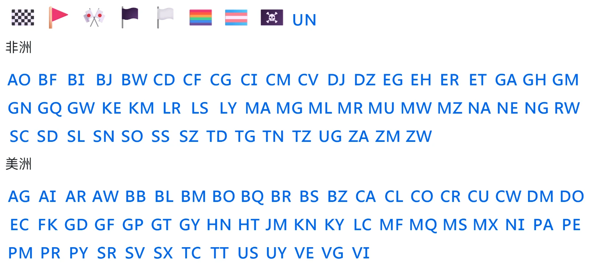
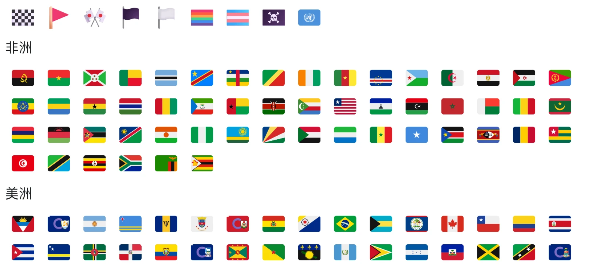

# Windows Flag Emoji

让 Windows 10 / 11 正常显示国旗 emoji。

Windows 自带的 Segoe UI Emoji 没有国旗,🇨🇳 🇺🇸 🇯🇵 只会显示成「CN」「US」「JP」两个字母。本工具把 [Twemoji](https://github.com/mozilla/twemoji-colr) 的 261 面旗帜并入系统自带的 Segoe UI Emoji,其它表情保持微软原样。

[English](#english)

## 效果

安装前 / Before:



安装后 / After:



| 场景 | 安装前 | 安装后 |
|---|---|---|
| 浏览器、微信、资源管理器标签页和地址栏等支持彩色字体的地方 | CN | 🇨🇳 彩色国旗 |
| 资源管理器文件列表等只能显示单色的地方 | CN | CN(与原来一样) |

- 支持全部国家/地区旗,以及英格兰、苏格兰、威尔士旗
- 同时写入 COLR v0 和 v1,新旧渲染方式都能显示
- 国旗大小、位置与 Segoe UI Emoji 的其它表情对齐

## 使用

需要 [Python 3.8+](https://www.python.org/downloads/)(安装时勾选 Add Python to PATH)。

1. 下载本仓库(Code → Download ZIP)并解压
2. 右键 `install.bat` → **以管理员身份运行**
3. 重启电脑

还原:右键 `restore.bat` → 以管理员身份运行 → 重启。

Windows 更新替换了 Segoe UI Emoji 之后,如果国旗又变回字母,重新运行一次 `install.bat` 即可。

## 原理

- 安装时从**你电脑上**的 `C:\Windows\Fonts\seguiemj.ttf` 生成 `seguiemj_flags.ttf`,复制到系统字体目录,再把注册表里 Segoe UI Emoji 指向新文件。
- **不修改、不覆盖任何系统文件**,不需要 PE。新文件正被占用时,会安排在重启时替换。
- 还原只是把注册表改回原值,再删掉新文件。

## 为什么不直接提供做好的字体

Segoe UI Emoji 是微软的字体,不能再分发。所以本仓库只提供脚本和 Twemoji 字体,字体在你自己电脑上生成。

## 自定义

`tools/build_emoji.py` 里的 `MONO_STYLE`:
- `"letters"`(默认):单色场景显示国家代码字母
- `"outline"`:单色场景显示旗帜线稿(需要 `pip install skia-pathops`)

也可以单独生成字体:

```
pip install fonttools
python tools/build_emoji.py [seguiemj.ttf] [Twemoji.Mozilla.ttf] [输出.ttf]
```

## 许可

- 脚本:MIT,见 [LICENSE](LICENSE)
- `src/Twemoji.Mozilla.ttf`:来自 [mozilla/twemoji-colr](https://github.com/mozilla/twemoji-colr) v0.7.0。图形 © Twitter, Inc 及其他贡献者,[CC-BY 4.0](https://creativecommons.org/licenses/by/4.0/)

---

## English

Windows ships Segoe UI Emoji without flag glyphs, so 🇨🇳 🇺🇸 🇯🇵 render as the letters "CN", "US", "JP". This tool merges the 261 Twemoji flags into your system's own Segoe UI Emoji and leaves every other emoji untouched.

- Color flags wherever color fonts are supported (browsers, chat apps, Explorer tabs and address bar). COLR v0 and v1 are both written.
- Where only monochrome glyphs are drawn (for example the Explorer file list), the country code letters are shown, the same as stock Windows.

**Install:** install [Python 3.8+](https://www.python.org/downloads/), right-click `install.bat` → *Run as administrator*, then reboot.
**Uninstall:** right-click `restore.bat` → *Run as administrator*, then reboot.

The font is built locally from `C:\Windows\Fonts\seguiemj.ttf`, copied under a new file name, and the registry entry for Segoe UI Emoji is pointed at it. No system file is modified or overwritten. Segoe UI Emoji is Microsoft's font and cannot be redistributed, which is why only the scripts are provided.

Scripts are MIT licensed. Flag artwork: Twemoji © Twitter, Inc and other contributors, CC-BY 4.0, via [mozilla/twemoji-colr](https://github.com/mozilla/twemoji-colr).
